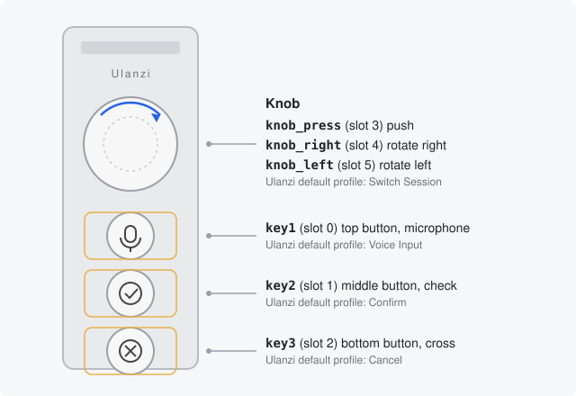

# au05ctl

[](https://github.com/kenwjj/au05ctl/actions/workflows/test.yml)

Program an **Ulanzi AU05 (Vibe Key)** hotkeys from a script and a JSON file, without Ulanzi Studio.

The AU05 keeps its key/knob bindings in firmware. This tool talks to the dongle's vendor HID interface and
reads/writes those bindings directly.

## Which slot is which



| slot name | id | physical control |
|---|---|---|
| `key1` | 0 | top button (microphone) |
| `key2` | 1 | middle button (check) |
| `key3` | 2 | bottom button (cross) |
| `knob_press` | 3 | push the knob |
| `knob_right` | 4 | rotate the knob right |
| `knob_left` | 5 | rotate the knob left |

The "Voice Input / Confirm / Cancel / Switch Session" labels are just Ulanzi's default profile; the slots
themselves can hold any hotkey.

## Setup (Windows, [uv](https://docs.astral.sh/uv/))

Requires Python 3.12+ (uv fetches it automatically).

```powershell
uv sync        # creates .venv, installs hidapi + the `au05` command from uv.lock
```

To install `au05` as a global command instead: `uv tool install .` (then run `au05 ...` from anywhere).

## Use

```powershell
uv run au05 show                       # read all slots from the device
uv run au05 apply --dry-run            # diff bindings.json against the device
uv run au05 apply                      # write changed slots, verify by read-back
uv run au05 set key2 "Ctrl+Alt+L"      # change one slot
uv run au05 dump mine.json             # save current device bindings
```

`au05.cmd` wraps `uv run` and works from any folder: `C:\path\to\au05ctl\au05.cmd show`.

## Tests

No hardware needed (real captured frames as vectors plus a fake HID device):

```powershell
uv run pytest
```

CI (`.github/workflows/test.yml`) runs `uv sync --locked` and `uv run pytest` on every push.

## Claude Code skill

`.claude/skills/au05ctl/SKILL.md` teaches Claude Code to run this CLI safely (back up first, dry-run before
apply, check Studio is closed and the device awake). It loads automatically when you open Claude Code in this
repo; copy the folder to `~/.claude/skills/` to use it from anywhere.

Slots: `key1 key2 key3 knob_press knob_right knob_left` (or `0..5`). Up to 4 keys per slot, written like
`Ctrl+Shift+]`, or in the raw Ulanzi form `E0|E1|30`. Edit `bindings.json` and run `apply`.

## Requirements and limits

- **Close Ulanzi Studio first.** Its read thread steals the device's replies (the tool refuses to run if it is open).
  Studio also re-pushes its own saved profile whenever it connects, overwriting what this tool wrote.
- **The AU05 must be awake.** The dongle alone answers heartbeats; slot commands need the device itself.
  Symptom of a sleeping device: `no reply for slot N`.
- Mouse-wheel bindings are not supported (format not captured).
- Whether bindings survive a device power cycle has not been verified.

See [docs/PROTOCOL.md](docs/PROTOCOL.md) for the wire format and how it was derived.

Tested on one AU05, firmware 4.6.3, Windows 10, Ulanzi Studio 3.x. Unofficial; not affiliated with Ulanzi.
Use at your own risk.
